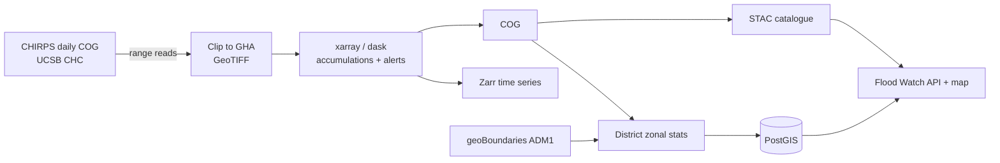

# IGAD Rainfall Monitoring Pipeline

An operational-style pipeline that turns open satellite rainfall data into flood early-warning products for the
Greater Horn of Africa (the 11 countries in ICPAC's domain: the 8 IGAD Member States plus Burundi, Rwanda and
Tanzania).

Every day it:

1. **Ingests** CHIRPS v2.0 daily rainfall. CHIRPS publishes global Cloud-Optimised GeoTIFFs, so only the regional
   window is read, using HTTP range requests (GDAL `/vsicurl/`).
2. **Processes** the last 30 days with `xarray` and `dask` into 1, 3, 7 and 30-day accumulations, plus a
   heavy-rainfall **alert level** raster (3-day totals ≥ 50 / 100 / 150 mm).
3. **Writes** each product as a **Cloud-Optimised GeoTIFF**, and appends the daily series to a **Zarr** store.
4. **Publishes** a **STAC** catalogue (PySTAC, with the projection extension) that has one Item per day.
5. **Summarises** each product per district (geoBoundaries ADM1) as mean, 90th percentile and max, and classifies
   each district's alert level.
6. **Loads** boundaries, statistics and alerts into **PostGIS**, where the
   [East Africa Flood Watch](https://github.com/Timoo20/ea-flood-watch) map and API read them.

The whole cycle is a **Prefect** flow with retries, scheduled at 06:00 EAT. It ships as a Docker image, is tested
in GitHub Actions, and has Terraform for its cloud storage.



## Products

| Product | Format | Path |
|---|---|---|
| Daily rainfall, GHA clip | GeoTIFF | `data/raw/chirps_YYYYMMDD.tif` |
| 1/3/7/30-day accumulated rainfall (mm) | COG | `data/cog/precip_{N}d_YYYYMMDD.tif` |
| Alert level (0–3, 255 = no data) | COG | `data/cog/alert_level_YYYYMMDD.tif` |
| Daily rainfall time series | Zarr | `data/zarr/chirps_gha_daily.zarr` |
| Catalogue | STAC 1.x | `data/stac/collection.json` |
| District statistics + alert level | CSV, PostGIS | `data/stats/`, tables `rainfall_stats`, `rainfall_alerts` |

## Quick start

```bash
pip install -e ".[dev,db]"
pytest -q                                   # offline tests on synthetic rasters

# One real run for the latest day CHIRPS has published (Kenya and Uganda only, to keep it quick)
COUNTRIES=KEN,UGA igad-rainfall --no-validate
# Or a specific day
igad-rainfall --date 2026-06-30
```

With PostGIS (Docker):

```bash
docker compose up -d postgis
docker compose run --rm pipeline --date 2026-06-30 --no-validate
```

## Scheduling with Prefect

```bash
prefect work-pool create gha-pool --type process
prefect deploy --all          # reads prefect.yaml: daily at 06:00 Africa/Nairobi
prefect worker start -p gha-pool
```

Ingestion retries 3 times per day of data, and the PostGIS load retries twice. Every step is **idempotent**:
re-running a day skips files that already exist, replaces that day's STAC Item and database rows, and never
appends duplicate days to Zarr. A failed run can therefore simply be re-run.

## Cloud storage (Terraform)

`infra/terraform` creates a Google Cloud Storage bucket in `africa-south1` for the products. It has versioning, a
lifecycle rule that expires raw clips, CORS for browser range requests, optional public read for open data, and a
least-privilege service account for the pipeline.

```bash
cd infra/terraform
terraform init && terraform apply -var project_id=<your-project>
export PUBLIC_BASE_URL=$(terraform output -raw public_base_url)   # STAC asset hrefs then point at the bucket
gcloud storage rsync -r ../../data/cog gs://$(terraform output -raw bucket)/cog
```

## Configuration

| Variable | Default | Meaning |
|---|---|---|
| `DATA_DIR` | `data` | Output root |
| `COUNTRIES` | 11 GHA ISO3 codes | Countries for district statistics |
| `ADMIN_LEVEL` | `ADM1` | geoBoundaries level (`ADM2` for finer districts) |
| `ACCUM_WINDOWS` | `1,3,7,30` | Accumulation windows in days (must include 3) |
| `ALERT_THRESHOLDS_MM` | `50,100,150` | 3-day thresholds for alert levels 1–3 |
| `DATABASE_URL` | empty | SQLAlchemy URL; empty skips the PostGIS load |
| `PUBLIC_BASE_URL` | empty | Base URL for STAC asset hrefs |

## Design notes

- **Missing data is not dry weather.** If any day in a window is missing, the pixel's accumulation is NaN, not
  a smaller total. Reporting a false "no alert" is worse than reporting "no data".
- **Small districts still get values.** Districts too small to contain a pixel centre at 0.05° (~5.5 km) are
  re-rasterised with `all_touched=True`.
- **Atomic writes.** Each download is written to a temporary file and renamed, so an interrupted run never leaves
  a half-written file that a later run would mistake for a finished one.
- **District alerts use the 90th percentile** of 3-day rainfall rather than the mean, so heavy rain over part of a
  large district is not averaged away. The maximum would make one noisy pixel trigger an alert.

## Limitations and next steps

- CHIRPS *final* data lags real time by several weeks. An operational system would use CHIRPS preliminary data
  or IMERG Early for monitoring, and a forecast (for example GEFS or ECMWF) for warnings.
- The thresholds are fixed values in mm. Return-period or percentile thresholds derived from a 1991–2020
  climatology are a better basis for impact-based warnings, and are the next feature.
- Rainfall is only a proxy for flooding. Coupling with GloFAS discharge or a hydrological model is the natural
  extension.
- Storage targets: Icechunk or VirtualiZarr references would avoid re-copying the archive.

## Data and licences

- Rainfall: [CHIRPS v2.0](https://www.chc.ucsb.edu/data/chirps), Climate Hazards Center, UC Santa Barbara (CC BY 4.0).
  Funk et al. (2015), *Scientific Data* 2, 150066.
- Boundaries: [geoBoundaries](https://www.geoboundaries.org) (CC BY 4.0 / open licences per country).
- Code: MIT.

This is a demonstration project, not an official warning service.
